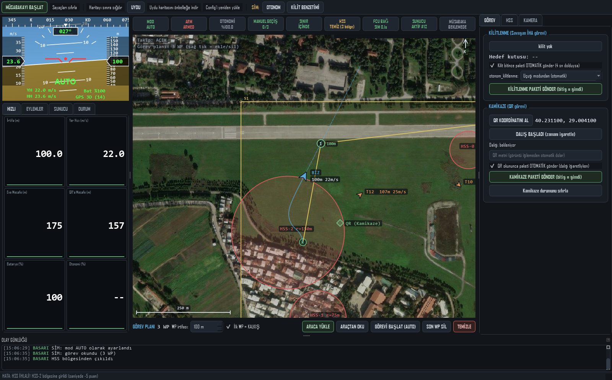

# Savaşan İHA Yer Kontrol İstasyonu (YKİ) — TEKNOFEST

Savaşan İHA Yarışma Şartnamesi ve Haberleşme Dokümanı isterlerine göre
geliştirilmiş yer kontrol istasyonu. **Ubuntu 22.04 + ROS 2 Humble + MAVROS**
üzerinde, **Pixhawk + Jetson/Raspberry Pi** mimarisi için tasarlandı.



```
Pixhawk ──USB/UART── Jetson (ROS 2 Humble + MAVROS + görüntü işleme)
                        │ MAVLink (UDP, gcs_url yönlendirme)  ─┐
                        │ kilit/QR JSON (UDP 42000)           ─┤
                        │ (seçenek) rosbridge websocket 9090  ─┤
                                                               ▼
                                              YKİ (bu uygulama, Ubuntu 22.04)
                                                               │ HTTP/JSON (ethernet)
                                                               ▼
                                                   Yarışma Sunucusu (http://IP:5000)
```

## Şartname isterleri nasıl karşılanıyor?

| İster (şartname) | YKİ'deki karşılığı |
|---|---|
| Haritada yarışma sınırları, rakip İHA'lar, aktif HSS bölgeleri (teknik kontrolde zorunlu) | Harita her zaman ekranda: sınır poligonu, sunucudan gelen rakipler (T10, T11...), kırmızı HSS daireleri, QR hedefi |
| Telemetri en az 1 Hz / en fazla 2 Hz | Ayarlanabilir 1.0–2.0 Hz; planlayıcı hiçbir koşulda 2 Hz'i aşamaz (varsayılan 1.5 Hz) |
| Telemetri doğrudan otopilottan | Veriler Pixhawk'tan (MAVLink/MAVROS) okunur; FCU verisi bayatlarsa gönderim otomatik durur ve alarm verilir (donuk paket = ihraç riski) |
| gps_saati alanı uçağın GPS saatinden (UTC) | MAVLink `SYSTEM_TIME` / MAVROS `time_reference`; yoksa kırmızı uyarı ile sistem saatine düşer |
| Kilitlenme: kesintisiz 4 sn, paket bitişten en geç 2 sn sonra | Kilit oturum sayacı + otomatik paket gönderimi (bitiş zamanı = hedefin son görüldüğü sunucu saati) |
| Kamikaze: dalış başlangıç/bitiş zamanı + QR metni, bitişten 2 sn içinde | "Dalış başladı" işareti + QR okununca otomatik gönderim |
| Sunucu saatine senkron | Periyodik `/api/sunucusaati` + her telemetri cevabından RTT telafili senkron |
| Manuel geçiş limiti 3 | Durum şeridinde canlı sayaç (X/3), aşımda kırmızı |
| ≥ %75 otonom uçuş | Müsabaka kronometresi ile canlı otonomi yüzdesi |
| Sınır dışına 10 sn = eleme | Sınır + irtifa bandı ihlal sayacı, sesli ikaz |
| HSS ihlali -5/sn, 30 sn'de iniş | Bölge içi süre sayacı ve ceza tahmini |
| Kamera görüntüsünün YKİ'ye aktarımı (tavsiye) | VİDEO sekmesi (rtsp/udp/gstreamer, isteğe bağlı opencv) |

## Kurulum (Ubuntu 22.04)

```bash
cd ~/Desktop/iha_yki        # klasörü YKİ bilgisayarına kopyalayın

sudo apt update
sudo apt install -y python3-pip python3-venv

python3 -m venv .venv
source .venv/bin/activate
pip install -r requirements.txt
# video paneli de istenirse: pip install opencv-python

# hızlı sağlık testi (arayüz açmadan uçtan uca protokol testi):
python3 selftest.py
```

### Jetson / Raspberry Pi tarafı (ROS 2 Humble + MAVROS)

```bash
sudo apt install -y ros-humble-mavros ros-humble-mavros-extras
ros2 run mavros install_geographiclib_datasets.sh   # bir kez (sudo ile)

# Pixhawk bağlantısı + YKİ'ye MAVLink yönlendirme (YKI_IP'yi kendi IP'nizle değiştirin):
ros2 launch mavros apm.launch fcu_url:=/dev/ttyACM0:921600 gcs_url:=udp://@192.168.1.10:14550
```

`gcs_url` sayesinde MAVROS, Pixhawk akışını YKİ'ye kopyalar; YKİ varsayılan
olarak `udpin:0.0.0.0:14550` dinler. (Alternatif: `mavlink-router`.)

**Seçenek — rosbridge üzerinden:** MAVLink yerine/yanında ROS konularıyla
beslemek isterseniz Jetson'da:

```bash
sudo apt install -y ros-humble-rosbridge-suite
ros2 launch rosbridge_server rosbridge_websocket_launch.xml
```

`config.yaml → baglanti.rosbridge_host` alanına Jetson IP'sini yazın.
"otomatik" kipte MAVLink birincildir; MAVLink akarken rosbridge verisi yok sayılır.

### Görüntü işleme entegrasyonu (kilitlenme + QR)

Jetson'daki takip/QR yazılımınız her karede YKİ'ye UDP JSON atar
(bkz. [ornekler/jetson_gorev_ornek.py](ornekler/jetson_gorev_ornek.py)):

```python
from jetson_gorev_ornek import YkiBildirici
b = YkiBildirici("192.168.1.10")                 # YKİ IP
b.kilit_bildir(True, cx, cy, w, h, 640, 480)     # her karede
b.qr_bildir("qr_icerigi")                        # QR çözülünce
```

Bu akış; telemetri paketindeki `iha_kilitlenme` / `hedef_*` alanlarını,
4 sn kilit sayacını ve kamikaze QR metnini otomatik besler.

## Çalıştırma

```bash
./baslat.sh                 # config.yaml ile normal çalışma
./baslat.sh --sim           # donanımsız deneme (benzetim uçuşu)
./baslat.sh --kaynak rosbridge
```

### Windows'ta çalıştırma (geliştirme/deneme için)

Uygulama saf Python olduğundan Windows'ta da çalışır (saha bilgisayarı yine
Ubuntu 22.04 olmalı):

```bat
pip install -r requirements.txt   :: bir kez
baslat_sim.bat                    :: çift tıkla: sahte sunucu + benzetim uçuşu birlikte açılır
baslat.bat                        :: normal çalışma (config.yaml ile)
baslat.bat --sim                  :: yalnız benzetim uçuşu
```

`baslat_sim.bat` sonrası YKİ'de: sunucu adresi `http://127.0.0.1:5000`,
kullanıcı adı `takimkadi`, şifre `takimsifresi` → GİRİŞ YAP.
Jetson'dan gerçek veri alınacaksa Windows Güvenlik Duvarı'nın Python için
UDP 14550 (MAVLink) ve 42000 (kilit/QR) portlarına izin vermesi gerekir.

Donanımsız tam prova için ikinci bir terminalde sahte yarışma sunucusu:

```bash
python3 sim_sunucu.py                       # 0.0.0.0:5000, kadi=takimkadi sifre=takimsifresi
python3 sim_sunucu.py --hss-baslangic 30    # 30 sn sonra HSS bölgeleri aktifleşir
```

ve YKİ'de sunucu adresi olarak `http://127.0.0.1:5000` girin. Kilit/QR akışını
denemek için üçüncü terminalde: `python3 ornekler/jetson_gorev_ornek.py`.

## Arayüz düzeni (Mission Planner "Flight Data" tarzı)

- **Orta: UYDU HARİTASI (büyük panel)** — ESRI World Imagery karoları (sağlayıcı
  config'ten değiştirilebilir) + şartname katmanları: sınır poligonu (S1..S4),
  rakipler, HSS daireleri, QR hedefi, kendi izimiz, ev noktası (H), GUIDED
  hedefi (mor), 15 sn'lik rota projeksiyonu ve **görev planı waypoint'leri**
  (numaralı daireler + sarı rota). Tekerlek=yakınlaştır, sürükle=kaydır,
  çift tık=takip. **SAĞ TIK menüsü:** *Waypoint ekle* · *WP sil* ·
  *Buraya Uç (GUIDED)* · *Ev noktasını işaretle* · *Buraya merkezle* ·
  *Koordinatı kopyala*.
- **Harita altı: GÖREV PLANI şeridi** — WP sayısı, yeni WP irtifası,
  "İlk WP = KALKIŞ" seçeneği ve **ARACA YÜKLE / ARAÇTAN OKU /
  GÖREVİ BAŞLAT (AUTO) / SON WP SİL / TEMİZLE** düğmeleri. Yükleme/okuma
  MAVLink görev protokolüyle yapılır (MISSION_COUNT → REQUEST → ITEM → ACK).
- **Sağ sekmeler** — **GÖREV** (kilitlenme + kamikaze paketleri), **HSS**
  (tablo + ihlal sayacı), **KAMERA** (canlı görüntü, isteğe bağlı).
- **Sol üst: HUD** — Mission Planner tarzı: yapay ufuk + dikilme merdiveni,
  yönelme şeridi, hava hızı / irtifa bantları, mod yazısı, DISARMED uyarısı.
- **Sol alt sekmeler** — **HIZLI** (büyük rakamlar), **EYLEMLER** (mod, ARM,
  irtifa/hız komutları), **SUNUCU** (giriş, saat senkronu, sayaçlar),
  **DURUM** (ayrıntılı telemetri).
- **Üst şerit** — MOD, ARM, OTONOMİ %, MANUEL GEÇİŞ x/3, SINIR, HSS, FCU,
  SUNUCU, müsabaka geri sayımı. Kritikler yumuşak kırmızı uyarı + sesli ikaz.
- **Alt** — olay günlüğü (FCU STATUSTEXT mesajları dahil); `kayitlar/`
  klasörüne de yazılır.

### Uydu haritası ve çevrimdışı kullanım

Karolar internetten indirilir ve `harita_onbellek/` klasörüne kaydedilir —
**bir kez indirilen bölge sahada internetsiz çalışır.** Yarışmadan önce
(internet varken) sınır koordinatlarını config'e girip araç çubuğundan
**"Uydu haritasını önbelleğe indir"** çalıştırın (z13–z18, sınır + 400 m pay).
Araç çubuğundaki **UYDU** düğmesi katmanı açıp kapatır; kapalıyken koyu
ızgara görünümü kullanılır. Sağlayıcı `config.yaml → harita.uydu.url`
alanından değiştirilebilir (ör. Google uydu şablonu yorum satırında).

### Araç komutları (MAVLink)

EYLEMLER sekmesi ve harita sağ tık menüsü komutları MAVLink üzerinden Pixhawk'a
gider (MAVROS `gcs_url` bağlantısı çift yönlüdür): mod değişimi, ARM/DISARM,
Mission Planner'ın "Fly To Here"'i ile aynı yöntemle GUIDED hedefi
(`MISSION_ITEM_INT`, current=2), `MAV_CMD_GUIDED_CHANGE_ALTITUDE` ile irtifa ve
`DO_CHANGE_SPEED` ile hız. `COMMAND_ACK` cevapları olay günlüğüne düşer.
rosbridge kaynağında mod + ARM komutları MAVROS servisleriyle çalışır; SİM
kaynağı tüm komutlara uyar (donanımsız prova için).

> Şartname 6.1.7: YKİ üzerinden komut göndermek (varış noktası tanımlama,
> irtifa/seyir hızı değiştirme, iniş komutu) **otonomiyi bozmaz**; kumanda ile
> uçuş manuel sayılır. Uçuş planı/komut stratejinizi hakem kuruluna önceden
> bildirmeyi unutmayın.

## Yarışma günü kontrol listesi

1. **Ağ:** hakemlerin verdiği IP'yi ethernet arayüzüne yazın; güvenlik duvarını
   kapatın: `sudo ufw disable` (haberleşme dokümanı isteri).
2. **config.yaml:** sunucu `url/kadi/sifre`, hakemlerin paylaştığı **sınır köşe
   koordinatları** ve **min/maks irtifa** değerlerini girin → arayüzden
   "Config'i yeniden yükle".
3. MAVROS'u `gcs_url` ile başlatın; üst şeritte **FCU** yeşil olmalı.
4. SUNUCU sekmesi → **GİRİŞ YAP** → takım numarası doğrulayın →
   **TELEMETRİYİ BAŞLAT** (teknik kontroldeki haberleşme testi bu ekrandan yapılır).
5. Görüntü işlemeyi başlatın; GÖREV sekmesinde hedef kutusunun aktığını görün.
6. Kalkıştan önce **MÜSABAKAYI BAŞLAT** (otonomi %/manuel geçiş sayaçları).
7. HSS duyurusu gelince HSS sekmesinde **Sürekli sorgula**yı açın.
8. Kamikaze öncesi **QR koordinatını al** (haritada görünür), dalışta
   **DALIŞ BAŞLADI**; QR okununca paket otomatik gider.

## Puan/ceza hatırlatması (şartname Tablo 4)

Otonom kilitlenme **+500** · Kamikaze **+300** · Otonom iniş **+100** ·
Otonom kalkış **+50** · Manuel kilitlenme **+50** · Canlı görüntü **+50**
— Hatalı kilit/kamikaze **-30** · Manuel geçiş aşımı **-10** · HSS **-5/sn** ·
Hatalı telemetri **-0.2/sn** · Alan işgali **-150** · Sınır dışı **-200** · İhraç **-75**

## Testler

```bash
python3 selftest.py                        # hızlı uçtan uca sağlık testi
python3 -m unittest discover -s test -v    # protokol + kural birim testleri
```

## Sık sorunlar

- **FCU KOPUK:** `gcs_url` IP'si yanlış ya da 14550 portu başka uygulamada
  (QGC/Mission Planner açıksa kapatın veya farklı port kullanın).
- **401 hataları:** oturum düşmüştür; YKİ otomatik yeniden giriş dener,
  gerekirse GİRİŞ YAP'a tekrar basın.
- **400 / hata kodu 3:** telemetri 2 Hz üstüne çıkmış demektir; `telemetri_hz`
  değerini düşürün (YKİ planlayıcısı normalde buna izin vermez).
- **GPS saati YOK uyarısı:** Pixhawk GPS kilidi bekleyin; uyarı sürerken
  gps_saati alanı YKİ sistem saatiyle doldurulur (yalnızca acil durum için).
